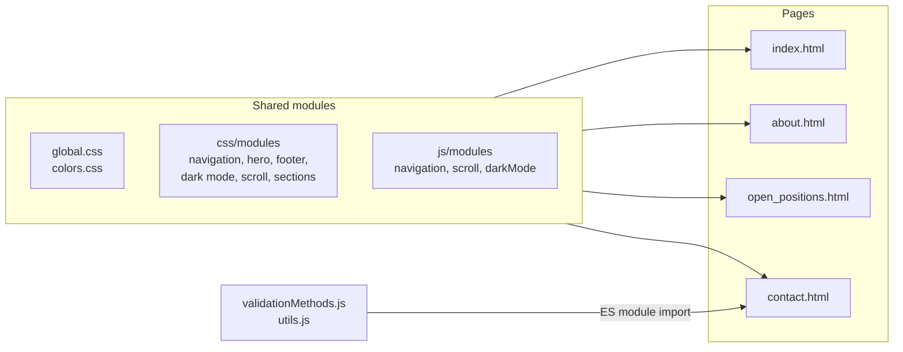

# 🌐 Digital Agency Website

**English** | [Srpski](README.sr.md)


A multi-page website for EPOS, a fictional agency that helps companies and entrepreneurs build their digital presence. It is built with plain HTML, CSS and JavaScript, without a framework or a build step, and includes a dark mode, a responsive layout and a contact form with its own validation module.

## Contents

- [Pages](#pages)
- [Features](#features)
- [Contact form](#contact-form)
- [How the code is organized](#how-the-code-is-organized)
- [Color palette](#color-palette)
- [Project structure](#project-structure)
- [Getting started](#getting-started)

## Pages

| Page | File | Content |
|---|---|---|
| **Home** | `index.html` | hero section, "Why us" cards, how the agency helps, contact call to action |
| **About us** | `pages/about.html` | mission, "Why us" cards, team slider |
| **Open positions** | `pages/open_positions.html` | job openings grouped by location, each card expands to show the details |
| **Contact** | `pages/contact.html` | contact form with validation and a summary of the submitted data |

The site content is in Serbian.

## Features

- **Dark mode**: switched with the moon icon in the navigation. The choice is saved in the `dark_mode` cookie for 365 days and applied before the page is drawn, so the page does not flash in light mode when moving between pages.
- **Responsive layout**: breakpoints at 991px, 768px and 576px. On small screens the navigation turns into a dropdown menu opened with a hamburger button.
- **Team slider**: built with the Slick carousel, it plays automatically and shows fewer cards on smaller screens.
- **Expandable job cards**: clicking a card on the Open positions page shows or hides its details.
- **Scroll to top button**: appears after the first 10% of the page and scrolls back to the top smoothly.

## Contact form

- **Reason for contact**: choosing a question about open positions shows an extra note for that choice.
- **Individual or company**: choosing "Company" shows two more fields (company name and tax ID), which then also become required.
- **Validation**: every field is checked when the form is sent, and each error is shown under its field. The error disappears as soon as the user starts typing in that field.
- **Result**: after a successful check, the form is replaced with a summary of the entered data and the date and time of sending. The values are written as plain text, so text such as `<b>Test</b>` is shown exactly as typed and not as HTML.

The form is not connected to a server: the data is only checked and shown in the browser.

### Validation module

`js/modules/validationMethods.js` is a small reusable module. Each field gets a list of rules, and each rule can have its own error message.

| Rule | Checks that the value |
|---|---|
| `required` | is not empty |
| `string` | is text |
| `email` | is a valid email address |
| `in` | is one of the allowed values |
| `between` | is within a range |
| `gt`, `gte` | is greater than (or equal to) a number |
| `lt`, `lte` | is less than (or equal to) a number |

## How the code is organized

Shared parts of the site (navigation, hero section, footer, dark mode...) have their own CSS and JS files in `modules/`, and every page loads them together with its own file from `pages/`.



## Color palette

| Color | Hex |
|---|---|
| Corn | `#FFF05A` |
| Orange Yellow Crayola | `#FFD25A` |
| Rajah | `#FFAA5A` |
| Coral | `#FF785A` |
| Eerie Black | `#191919` |

## Project structure

```
digital-agency-website/
├── index.html                  # home page
├── pages/
│   ├── about.html
│   ├── open_positions.html
│   └── contact.html
├── css/
│   ├── global.css              # base styles, buttons, sections, form fields
│   ├── colors.css              # color palette classes
│   ├── modules/                # styles shared between pages
│   └── pages/                  # styles for a single page
├── js/
│   ├── modules/                # navigation, scroll, dark mode, validation
│   └── pages/                  # scripts for a single page
└── images/
    ├── icons/
    └── team/
```

## Getting started

The contact page loads its scripts as ES modules, and the browser blocks them when the page is opened directly from the disk (`file://`). Dark mode also relies on a cookie, which browsers do not save for `file://` pages. Because of that the site has to be opened through a local web server.

**XAMPP**

1. Copy the project folder into `xampp/htdocs`.
2. Start **Apache** in the XAMPP Control Panel.
3. Open `http://localhost/digital-agency-website/` (if Apache uses another port, add it, e.g. `http://localhost:8081/...`).

**VS Code**

1. Install the **Live Server** extension.
2. Right-click `index.html` and choose **Open with Live Server**.

jQuery and Slick are loaded from a CDN, so an internet connection is needed.
