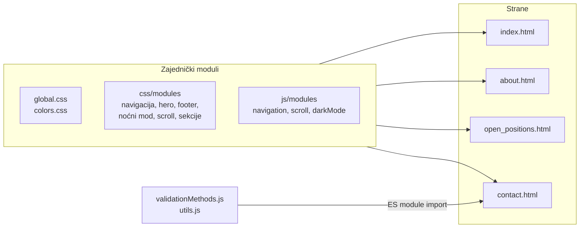

# 🌐 Sajt digitalne agencije

[English](README.md) | **Srpski**


Sajt od više strana za EPOS, izmišljenu agenciju koja pomaže firmama i preduzetnicima da izgrade digitalno prisustvo. Napravljen je u čistom HTML-u, CSS-u i JavaScript-u, bez frameworka i bez build koraka, i ima noćni mod, prilagođen prikaz za sve veličine ekrana i kontakt formu sa sopstvenim modulom za validaciju.

## Sadržaj

- [Strane](#strane)
- [Funkcionalnosti](#funkcionalnosti)
- [Kontakt forma](#kontakt-forma)
- [Organizacija koda](#organizacija-koda)
- [Paleta boja](#paleta-boja)
- [Struktura projekta](#struktura-projekta)
- [Pokretanje](#pokretanje)

## Strane

| Strana | Fajl | Sadržaj |
|---|---|---|
| **Početna** | `index.html` | hero sekcija, kartice „Zašto baš mi“, kako agencija pomaže, poziv na kontakt |
| **O nama** | `pages/about.html` | misija, kartice „Zašto baš mi“, slider sa timom |
| **Otvorene pozicije** | `pages/open_positions.html` | oglasi za posao po lokacijama, svaka kartica se otvara i prikazuje detalje |
| **Kontakt** | `pages/contact.html` | kontakt forma sa validacijom i pregledom poslatih podataka |

## Funkcionalnosti

- **Noćni mod**: uključuje se ikonicom meseca u navigaciji. Izbor se čuva u kolačiću `dark_mode` 365 dana i primenjuje se pre iscrtavanja strane, pa strana ne bljesne u svetlom modu pri prelasku sa strane na stranu.
- **Prilagođen prikaz**: prelomne tačke na 991px, 768px i 576px. Na malim ekranima navigacija postaje padajući meni koji se otvara hamburger dugmetom.
- **Slider sa timom**: napravljen pomoću Slick biblioteke, sam se pomera i na manjim ekranima prikazuje manje kartica.
- **Kartice oglasa koje se otvaraju**: klik na karticu na strani Otvorene pozicije prikazuje ili sakriva detalje.
- **Dugme za povratak na vrh**: pojavljuje se posle prvih 10% strane i glatko vraća na vrh.

## Kontakt forma

- **Razlog za kontakt**: izbor upita u vezi otvorenih pozicija prikazuje dodatnu napomenu.
- **Fizičko lice ili firma**: izbor „Firma“ prikazuje još dva polja (naziv kompanije i PIB), koja tada postaju i obavezna.
- **Validacija**: svako polje se proverava pri slanju forme, a greška se prikazuje ispod polja. Greška nestaje čim korisnik počne da kuca u to polje.
- **Rezultat**: posle uspešne provere forma se zamenjuje pregledom unetih podataka i datumom i vremenom slanja. Vrednosti se ispisuju kao običan tekst, pa se tekst kao `<b>Test</b>` prikazuje tačno onako kako je unet, a ne kao HTML.

Forma nije povezana sa serverom: podaci se samo proveravaju i prikazuju u browseru.

### Modul za validaciju

`js/modules/validationMethods.js` je mali modul koji može ponovo da se koristi. Svako polje dobija spisak pravila, a svako pravilo može da ima svoju poruku o grešci.

| Pravilo | Proverava da li je vrednost |
|---|---|
| `required` | uneta |
| `string` | tekst |
| `email` | ispravna email adresa |
| `in` | jedna od dozvoljenih vrednosti |
| `between` | u zadatom opsegu |
| `gt`, `gte` | veća od broja (ili jednaka) |
| `lt`, `lte` | manja od broja (ili jednaka) |

## Organizacija koda

Delovi sajta koji se ponavljaju (navigacija, hero sekcija, footer, noćni mod...) imaju svoje CSS i JS fajlove u `modules/`, a svaka strana ih učitava zajedno sa svojim fajlom iz `pages/`.



## Paleta boja

| Boja | Hex |
|---|---|
| Corn | `#FFF05A` |
| Orange Yellow Crayola | `#FFD25A` |
| Rajah | `#FFAA5A` |
| Coral | `#FF785A` |
| Eerie Black | `#191919` |

## Struktura projekta

```
digital-agency-website/
├── index.html                  # početna strana
├── pages/
│   ├── about.html
│   ├── open_positions.html
│   └── contact.html
├── css/
│   ├── global.css              # osnovni stilovi, dugmad, sekcije, polja forme
│   ├── colors.css              # klase za paletu boja
│   ├── modules/                # stilovi zajednički za više strana
│   └── pages/                  # stilovi za jednu stranu
├── js/
│   ├── modules/                # navigacija, scroll, noćni mod, validacija
│   └── pages/                  # skripte za jednu stranu
└── images/
    ├── icons/
    └── team/
```

## Pokretanje

Kontakt strana učitava skripte kao ES module, a browser ih blokira kad se strana otvori direktno sa diska (`file://`). Noćni mod koristi kolačić, koji browseri ne čuvaju za `file://` strane. Zato sajt mora da se otvori preko lokalnog web servera.

**XAMPP**

1. Kopiraj folder projekta u `xampp/htdocs`.
2. U XAMPP Control Panel-u pokreni **Apache**.
3. Otvori `http://localhost/digital-agency-website/` (ako Apache radi na drugom portu, dodaj ga, npr. `http://localhost:8081/...`).

**VS Code**

1. Instaliraj ekstenziju **Live Server**.
2. Desni klik na `index.html` → **Open with Live Server**.

jQuery i Slick se učitavaju sa CDN-a, pa je potrebna internet konekcija.
